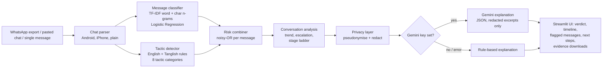

# SafeSignal

**See the warning signs in a chat, how they build up over time, and what to do next.**

Built for HackNowa Global Hackathon 2026, track: **Digital Safety & Cybersecurity**.

## The problem

Online harassment rarely starts with a threat. It usually builds: a stranger asks where you are, then asks you to keep the chat secret, then asks for a photo, then threatens to leak it. Each message alone can look harmless, so people often realise what is happening only at the last step. Most safety tools judge single messages in English only, while many Indian users chat in Tamil/English mixed text (Tanglish).

## What SafeSignal does

- **Check a message**: paste one message and get a risk level, the tactic it matches, and the exact words that triggered it.
- **Analyse a chat**: upload a WhatsApp export (Android or iPhone) or paste a chat. SafeSignal scores every message from the other person, draws a risk timeline, and checks whether tactics appear in an escalating order: probing, isolating, exploiting, threatening.
- **Explain and guide**: a plain-language explanation (Gemini, optional) plus specific next steps and Indian helplines (112, 181, 1930, cybercrime.gov.in).
- **Keep evidence**: download an evidence summary with a SHA-256 fingerprint of the original chat file, and a per-message CSV.
- **English and Tanglish**: both the classifier (character n-grams) and the tactic detector handle code-mixed text.

## How it works



**Design choice:** the risk level always comes from SafeSignal's own classifier and rules, which run locally and are explainable. The LLM only turns that evidence into plain language and never sees names, phone numbers, emails, UPI IDs, card or ID numbers, or OTPs.

### Scoring

- Classifier risk = P(POSSIBLE_THREAT) × 0.5 + P(THREAT). Values under 0.2 are treated as noise; very short messages without a matched tactic count for half.
- Tactic score = noisy-OR of the matched categories' weights.
- Message risk = 1 − (1 − 0.9 × classifier) × (1 − tactic). Levels: SAFE < 0.35 ≤ POSSIBLE_THREAT < 0.65 ≤ THREAT.
- Escalation = either the last third of the chat averages at least 0.15 higher than the first third (and is itself concerning), or two or more tactic stages appear in increasing order.

## Evaluation

`python train.py` reports two numbers, and the app shows both under **How it works**:

| Measure | What it tests | Result on the bundled starter data |
|---|---|---|
| Held-out accuracy / macro F1 | 20% split of the training data | 92% / 0.91 |
| Probe set accuracy | 30 hand-written realistic messages in `data/probe_set.csv`, not built from training templates | 87% |

The gap between the two is expected: the starter data is template-based, so the held-out score is optimistic. The probe set is the more honest measure. Its remaining errors are listed in the app. The tactic layer adds coverage for phrasings the classifier misses.

## Run it locally (Windows)

```powershell
cd safesignal
py -3.12 -m venv .venv
.venv\Scripts\activate
pip install -r requirements.txt
python train.py
python -m pytest -q
streamlit run app.py
```

Optional Gemini explanations: copy `.env.example` to `.env` and add a key from Google AI Studio. Without a key everything still works, using rule-based explanations.

### Using a larger dataset

Put any CSV with columns `text,label` (labels `SAFE`, `POSSIBLE_THREAT`, `THREAT`) in `data/`, then run `python train.py`. Every CSV in `data/` except `probe_set.csv` is used.

## Project structure

```
safesignal/
  app.py                    Streamlit interface
  config.py                 settings, thresholds, secrets lookup
  train.py                  trains and evaluates the classifier
  modules/
    chat_parser.py          WhatsApp (Android/iPhone) and plain chat parsing
    classifier.py           TF-IDF + logistic regression pipeline
    patterns.py             tactic detector (English + Tanglish)
    risk_timeline.py        per-message risk, trend, escalation, stages
    privacy.py              redaction, pseudonyms, file fingerprint
    llm.py                  Gemini explanation + rule-based fallback
    resources.py            next steps and Indian helplines
    report.py               evidence summary (.md) and analysis (.csv)
  data/dataset.csv          starter dataset (synthetic, English + Tanglish)
  data/probe_set.csv        hand-written evaluation set
  assets/sample_chats/      demo chats (escalating, Tanglish, safe)
  scripts/build_sample_dataset.py
  tests/                    29 pytest tests
```

## Deploy (Streamlit Community Cloud, free)

1. Push this repository to GitHub (public).
2. Go to share.streamlit.io, choose **Create app**, select the repo, branch `main`, main file `app.py`.
3. Optional: under **Advanced settings → Secrets**, add `GEMINI_API_KEY = "your-key"`.
4. Deploy. The model trains automatically on first start (a few seconds).

## Privacy

- Chats are processed in memory; the app writes nothing to disk.
- Only redacted, pseudonymised excerpts of flagged messages are sent to Gemini, and only when a key is set and the toggle is on. The app shows exactly what was sent.

## Limitations

- The starter dataset is small and partly synthetic; new phrasings can be missed or harmless messages flagged.
- Text only: images, voice notes and sarcasm are not understood.
- Tanglish coverage is limited to common romanised spellings.
- Helpline details should be confirmed on official websites.
- SafeSignal supports a person's judgement; it does not replace police, legal or counselling help.

## Built with

Python, Streamlit, scikit-learn, pandas, Altair, Google Gemini API (optional).
